  

# 🛡️ Awesome Zero Trust Security Architecture

  
  
  
  
  
  
  

> 🌐 **Awesome Zero Trust Security Architecture** is an authoritative, SEO-curated compilation of the best **Zero Trust Network Access (ZTNA)**, **Secure Access Service Edge (SASE)**, **Security Service Edge (SSE)**, and **Software-Defined Perimeter (SDP)** solutions. Discover leading enterprise commercial SaaS platforms alongside actively maintained, battle-tested open-source self-hosted alternatives designed around continuous verification, least privilege, and identity-aware micro-segmentation.
>
> 🌟 **Star this repository if you find it helpful for designing or migrating your cybersecurity architecture!** 🌟

---

## 📑 Table of Contents

- [🌐 Sector Overview & Market Dynamics](#-sector-overview--market-dynamics)
- [🟦 SaaS / Hosted Platforms](#-saas--hosted-platforms)
- [🟩 Open-Source Software](#-open-source-software)
- [📊 Feature Comparison Matrix](#-feature-comparison-matrix)
- [📈 Star History](#-star-history)
- [💖 Support & Sponsorship](#-support--sponsorship)
- [🤝 Contributing](#-contributing)
- [📄 License](#-license)

---

## 🌐 Sector Overview & Market Dynamics

The global **Zero Trust Security Architecture** market is valued at approximately **$35 billion to $42 billion (2024–2025)** and is projected to exceed **$90 billion by 2030**, advancing at a Compound Annual Growth Rate (CAGR) of **16%–17.3%**. 

From a market structure standpoint, the sector is **moderately concentrated at the enterprise platform tier**—where a handful of dominant cybersecurity and cloud conglomerates (such as Microsoft, Palo Alto Networks, Cisco, and Zscaler) secure the bulk of Fortune 500 infrastructure—yet remains **highly fragmented across niche specialized capabilities** (such as identity-aware proxies, micro-segmentation, ephemeral JIT access, and decentralized mesh overlays), ensuring active competition rather than a pure winner-take-all monopoly.

---

## 🟦 SaaS / Hosted Platforms

Below is a detailed comparison of premier commercial SaaS and cloud-hosted Zero Trust platforms, sorted in descending order by **Company Size (Revenue / Market Capitalization)**:

| Platform / Vendor | Company Size (Market Cap / Rev) | Starting Price (Specific Tier) | Free Tier / Trial Limit | Key Architectural Focus | Deployment Model |
| :--- | :--- | :--- | :--- | :--- | :--- |
| **[Microsoft Entra Private Access](https://www.microsoft.com/en-us/security/business/identity-access/microsoft-entra-private-access)** | ~$3.1 Trillion Market Cap / $245B+ Rev | **$5.00/user/month** (Standalone Private Access, annual commitment) | **No permanent free tier**; 30-day free trial (up to 100 user licenses via Microsoft Entra Suite) | Identity-centric private access extending Conditional Access across all TCP/UDP ports without legacy VPN | Cloud SSE / Microsoft 365 Fabric |
| **[Cisco Secure Access](https://www.cisco.com/site/us/en/products/security/secure-access/index.html)** | ~$230 Billion Market Cap / $54B+ Rev | **$5.00/user/month** (~$60/user/year list for Essentials base tier; 50-user min) | **No permanent free tier**; 14-day fully featured proof-of-concept trial upon partner approval | Converged SSE delivering unified ZTNA, SWG, CASB, and FWaaS with VPNaaS failover | Global Cloud SSE Fabric |
| **[Palo Alto Prisma Access](https://www.paloaltonetworks.com/sase/prisma-access)** | ~$115 Billion Market Cap / $8.0B+ Rev | **$10.00/user/month** ($120/user/year list for ZTNA Edition; 200-seat minimum) | **No permanent free tier**; 30-day proof-of-concept lab trial via certified partner | AI-driven SASE featuring automated ZTNA Connectors, App-ID, and inline Precision AI threat inspection | Worldwide Distributed Multi-Cloud |
| **[Cloudflare Zero Trust](https://www.cloudflare.com/zero-trust/)** | ~$35 Billion Market Cap / $1.7B+ Rev | **$7.00/user/month** (Pay-as-you-go Plan, billed annually) | **Free forever plan: Up to 50 users included** (includes Cloudflare Access, DNS gateway filtering, and 3 locations) | Global Anycast edge network combining clientless browser isolation, ZTNA, CASB, and DNS firewall | Distributed Edge (330+ Cities) |
| **[Zscaler Private Access (ZPA)](https://www.zscaler.com/products/zscaler-private-access)** | ~$30 Billion Market Cap / $2.1B+ Rev | **$6.00/user/month** (~$72/user/year base GSA schedule tier; 50-user min) | **No permanent free tier**; 30-day guided enterprise PoC trial for qualified domains | Inside-out outbound micro-tunnels making internal apps dark to the internet with AI segmentation | Zscaler Zero Trust Exchange |
| **[Akamai Enterprise Defender](https://www.akamai.com/products/enterprise-application-access)** | ~$15 Billion Market Cap / $3.9B+ Rev | **$10.00/user/month** (~$120/user/year standalone Enterprise Application Access) | **No permanent free tier**; 60-day enterprise evaluation trial upon sales verification | Edge-integrated identity-aware reverse proxy integrated with Kona WAF and CDN routing | Akamai Intelligent Edge |
| **[Netskope Private Access](https://www.netskope.com/products/private-access)** | ~$7.5 Billion Valuation / $500M+ ARR | **$8.50/user/month** ($102/user/year for 1,000+ seat tier; $114/user/year for 100–999 users) | **No permanent free tier**; 30-day enterprise proof-of-value trial on the NewEdge platform | ZTNA powered by AIOps agents to auto-generate precise FQDN application segments | Netskope NewEdge Network |
| **[Perimeter 81 (SonicWall)](https://www.perimeter81.com/)** | ~$1.0 Billion Enterprise Valuation | **$8.00/user/month** (Essentials Tier, billed annually; 5-user minimum) | **No permanent free tier**; 30-day money-back guarantee with a 14-day assisted business trial | Turnkey cloud SDP/ZTNA designed for fast mid-market deployment with built-in SWG | Multi-Tenant Cloud Edge |
| **[Twingate](https://www.twingate.com/)** | ~$350 Million Valuation / Series B | **$5.00/user/month** (Teams Tier, billed annually; up to 50 users) | **Free forever plan: Up to 5 users included** (includes 1 remote network, 2 connectors, and native IdP integration) | Peer-to-peer identity firewall providing ephemeral, zero standing privilege access for staff & AI agents | Split-Tunnel Cloud Controller |

---

## 🟩 Open-Source Software

Curated, community-driven, and self-hosted open-source Zero Trust solutions. The repositories below are sorted in descending order by **GitHub_Stars_Count**:

| Project / Repository | GitHub_Stars | Technology Stack | License | Key Capabilities |
| :--- | :---: | :--- | :--- | :--- |
| **[NetBird](https://github.com/netbirdio/netbird)** |  | Go, WireGuard, React | AGPL-3.0 | Complete open-source identity-based Zero Trust overlay network powered by kernel WireGuard mesh routing, multi-factor SSO, and granular ACL policy rules. |
| **[Teleport](https://github.com/gravitational/teleport)** |  | Go, Rust, WebAssembly | AGPL-3.0 / Apache 2.0 | Modern infrastructure access plane providing zero-trust identity-based access for SSH, Kubernetes clusters, databases, Windows desktops, and internal web applications. |
| **[Firezone](https://github.com/firezone/firezone)** |  | Rust, Elixir, Swift, Kotlin | Apache-2.0 | Next-generation WireGuard-based ZTNA platform designed to replace legacy remote VPNs with granular role-based resource access, continuous posture checks, and modern IdP SSO. |
| **[Pomerium](https://github.com/pomerium/pomerium)** |  | Go, Envoy Proxy | Apache-2.0 | Self-hosted, identity-aware reverse proxy implementing continuous session verification against identity, device posture, and context without decrypting traffic at third parties. |
| **[OpenZiti](https://github.com/openziti/ziti)** |  | Go, C, Python, Swift | Apache-2.0 | Programmable zero-trust overlay fabric enabling application-embedded zero trust connectivity with software SDKs, eliminating inbound firewall ports and public DNS records. |
| **[Octelium](https://github.com/octelium/octelium)** |  | Go, Kubernetes, QUIC | PolyForm Perimeter | Kubernetes-native Layer 7 unified Zero Trust platform offering secretless resource access, ABAC policy-as-code via CEL/OPA, clientless BeyondCorp proxies, and AI agent/MCP gateways. |
| **[Ory Oathkeeper](https://github.com/ory/oathkeeper)** |  | Go | Apache-2.0 | Cloud-native Identity & Access Proxy (IAP) and policy decision point inspired by Google BeyondCorp, authenticating, authorizing, and mutating incoming HTTP(S) requests. |
| **[DefGuard](https://github.com/DefGuard/defguard)** |  | Rust, Vue.js | Apache-2.0 | Enterprise-ready Zero Trust VPN gateway combining WireGuard, real-time multi-factor authentication (2FA/WebAuthn/TOTP), LDAP/OpenID identity sync, and device enrollment. |
| **[Pritunl Zero](https://github.com/pritunl/pritunl-zero)** |  | Python | Pritunl Free License | Zero Trust BeyondCorp access server granting secure, browser-based SSO and role-based access to internal web services and SSH bastions without installing client software. |
| **[FerrumGate](https://github.com/ferrumgate/secure.install)** |  | Go, Python, Docker | GPL-3.0 / Commercial | Software-Defined Perimeter (SDP) and ZTNA gateway orchestrating secure micro-segmented access to internal apps, RDP, and databases through Dockerized microservices. |

---

## 📊 Feature Comparison Matrix

| Solution Name | Deployment | Primary Model | Clientless Web Access | Ephemeral / JIT Access | Device Posture Check | Best Architectural Match |
| :--- | :---: | :---: | :---: | :---: | :---: | :--- |
| **Microsoft Entra Private Access** | Cloud SSE | ZTNA | ❌ | ✅ (PIM) | ✅ (Intune) | Large Microsoft 365 / Azure enterprise stacks |
| **Cisco Secure Access** | Cloud SSE | SASE / SSE | ✅ (HTTP) | ❌ | ✅ (AnyConnect) | Cisco enterprise routing & ThousandEyes environments |
| **Palo Alto Prisma Access** | Cloud SSE | SASE | ❌ | ❌ | ✅ (GlobalProtect) | Hybrid enterprises requiring deep Next-Gen FW inspection |
| **Cloudflare Zero Trust** | Edge Anycast | SASE / ZTNA | ✅ (SSH, VNC, Web) | ❌ | ✅ (WARP) | Fast-moving teams demanding unified edge performance |
| **Zscaler Private Access** | Cloud Native | ZTNA | ✅ (Browser) | ❌ | ✅ (Zscaler Client) | Global corporate workforces replacing branch VPNs |
| **Akamai Enterprise Defender** | Intelligent Edge | ZTNA + WAF | ✅ | ❌ | ✅ | Internet-facing web application security & CDN delivery |
| **Netskope Private Access** | Cloud SSE | ZTNA | ❌ | ❌ | ✅ | Data-sensitive enterprises needing granular CASB & DLP |
| **Perimeter 81 (SonicWall)** | Cloud Edge | SDP / SASE | ❌ | ❌ | ✅ | Mid-market businesses wanting turnkey zero-trust setup |
| **Twingate** | Distributed | Identity Firewall | ❌ | ✅ (Native JIT) | ✅ (Zero Trust) | Modern engineering squads, DevOps, and AI agent workloads |
| **NetBird** | Self-Hosted / SaaS | WireGuard Mesh | ❌ | ❌ | ✅ | Peer-to-peer hybrid cloud & private container meshes |
| **Teleport** | Self-Hosted / SaaS | Zero Trust Access | ✅ (Web UI) | ✅ (Dual Auth) | ✅ (TPM) | Multi-cloud engineers needing unified SSH, DB & K8s access |
| **Firezone** | Self-Hosted / SaaS | WireGuard ZTNA | ❌ | ❌ | ✅ | Modern alternative to OpenVPN & WireGuard servers |
| **Pomerium** | Self-Hosted | Identity Proxy | ✅ | ❌ | ✅ | Internal web applications needing continuous authentication |
| **OpenZiti** | Self-Hosted | Mesh Overlay | ✅ (Ziti SDK) | ❌ | ✅ | Developers embedding zero-trust networking directly in code |
| **Octelium** | Self-Hosted (K8s) | L7 SDP / Gateway | ✅ | ✅ (No Admin) | ✅ (WebAuthn) | Cloud-native Kubernetes platforms and AI/MCP agents |
| **Ory Oathkeeper** | Self-Hosted | Reverse Proxy | ✅ | ❌ | ❌ | Cloud-native microservices and API gateway authorization |
| **DefGuard** | Self-Hosted | WireGuard VPN | ❌ | ❌ | ✅ (YubiKey) | Homelabs and enterprises needing WireGuard with true 2FA |
| **Pritunl Zero** | Self-Hosted | BeyondCorp Proxy | ✅ | ❌ | ❌ | Frictionless browser-based SSH and internal web portal access |
| **FerrumGate** | Self-Hosted | SDP Gateway | ✅ | ❌ | ✅ | Fast Docker-based SDP deployment for SMB infrastructure |

---

## 📈 Star History

---

## 💖 Support & Sponsorship

If **Awesome Zero Trust Security Architecture** has streamlined your security evaluations, saved your engineering team hours of research, or helped protect your infrastructure:

- ⭐ **Star this repository** to help other cybersecurity professionals find it.
- 🍴 **Fork it** and contribute improvements, updates, or newly discovered tools.
- 📢 **Share it** on LinkedIn, X/Twitter, Discord, or with your internal SecOps/DevOps groups.
- ☕ **Buy us a coffee:** You can support the ongoing curation and maintenance of this list directly on the [GitHub Sponsors Dashboard](https://github.com/sponsors/ishandutta2007). Your support keeps these resources independent, fresh, and thoroughly verified!

---

## 🤝 Contributing

Contributions are warmly welcomed! If you have developed or discovered an open-source Zero Trust tool, ZTNA platform, or SDP service:

1. 🍴 Fork the repository.
2. 🌿 Create a feature branch: `git checkout -b feature/add-new-tool`.
3. 📝 Add your entry with accurate metadata (description, stack, license, and repository URL).
4. 🚀 Open a Pull Request following standard conventions.

---

## 📄 License

This compilation is dedicated to the public domain under the [Creative Commons Zero v1.0 Universal](LICENSE) (CC0 1.0). Third-party trademarks and software projects retain their respective proprietary or open-source licenses.
